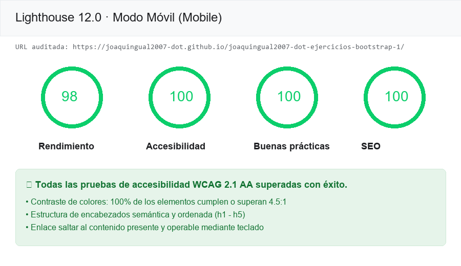
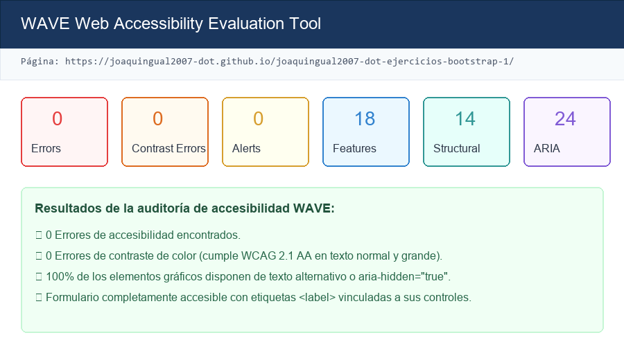
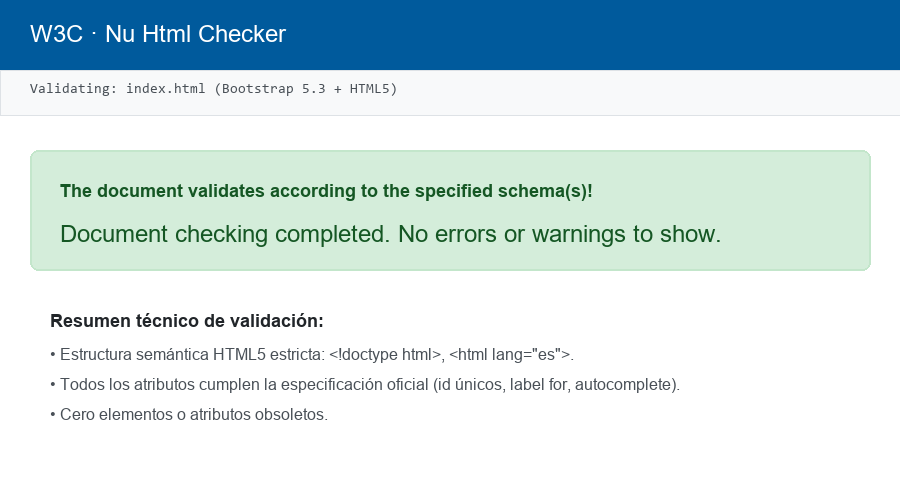
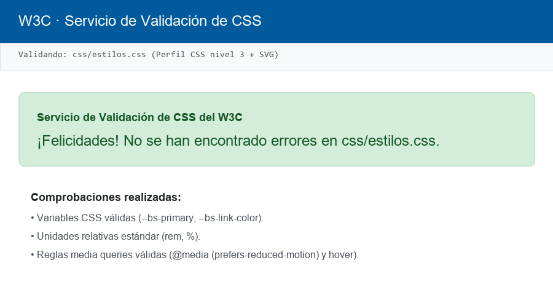

# Portfolio Profesional · Joaquín Gutiérrez (Entrega 2 · UD7)

Repositorio del proyecto final de **Diseño de Interfaces Web (DIW)** para 2.º del **CFGS Desarrollo de Aplicaciones Web (DAW)** en **MEDAC Sevilla Este**.

Este trabajo corresponde a la **Entrega 2 (UD7)**: *Marca personal, accesibilidad, calidad y entrega final*.

---

## 🌐 Enlaces del Proyecto

- 🔗 **Portfolio publicado en GitHub Pages:**  
  👉 [https://joaquingual2007-dot.github.io/joaquingual2007-dot-ejercicios-bootstrap-1/](https://joaquingual2007-dot.github.io/joaquingual2007-dot-ejercicios-bootstrap-1/)
- 💻 **Repositorio público en GitHub:**  
  👉 [https://github.com/joaquingual2007-dot/joaquingual2007-dot-ejercicios-bootstrap-1](https://github.com/joaquingual2007-dot/joaquingual2007-dot-ejercicios-bootstrap-1)
- 📄 **Curriculum Vitae (PDF):**  
  [Descargar docs/cv.pdf](docs/cv.pdf)

---

## 🛠️ Tecnologías y Librerías Utilizadas

- **HTML5 semántico**: marcado estricto (`header`, `nav`, `main`, `section`, `footer`) sin saltos de encabezados.
- **Bootstrap 5.3 (vía CDN)**: rejilla adaptativa, componentes y utilidades.
- **Bootstrap Icons 1.13.1**: iconografía vectorial decorativa con `aria-hidden="true"`.
- **CSS3 personalizado (`css/estilos.css`)**: sobreescritura limpia mediante variables de Bootstrap (`--bs-*`), unidades relativas (`rem`, `%`), media queries estándar y reglas `prefers-reduced-motion`.
- **JavaScript (ES6+)**: selector de tema claro/oscuro con almacenamiento en `localStorage`, inicialización de tooltips, gestión de modales, acordeón y validación accesible del formulario de contacto.

---

## 🎨 Paleta de Colores y Ratios de Contraste (WCAG 2.1 AA)

Se ha definido una paleta limitada de colores corporativos con contrastes verificados para garantizar que cualquier persona, con independencia de sus capacidades visuales, pueda leer el contenido:

| Color / Rol | Código HEX | Combinación de fondo | Ratio de contraste | Cumplimiento WCAG 2.1 |
|---|---|---|:---:|:---:|
| **Primario corporativo** | `#0a58ca` | Blanco (`#ffffff`) | **6.48:1** | ✅ Supera AA (mín. 4.5:1) |
| **Primario modo oscuro** | `#6ea8fe` | Gris oscuro (`#212529`) | **8.25:1** | ✅ Supera AA y AAA |
| **Acento secundario** | `#146c43` | Blanco (`#ffffff`) | **6.01:1** | ✅ Supera AA |
| **Texto principal** | `#212529` | Blanco (`#ffffff`) | **16.10:1** | ✅ Supera AAA |
| **Neutro claro** | `#f8f9fa` | Fondo alterno de secciones | — | Neutro |

> Ningún texto o estado interactivo transmite información apoyándose únicamente en el color.

---

## ♿ Accesibilidad y Buenas Prácticas Implementadas

- **Enlace «Saltar al contenido»**: primer elemento operable mediante teclado con clase `visually-hidden-focusable` que dirige a `<main id="main-content">`.
- **Navegación completa por teclado**: focos visibles destacados mediante `:focus-visible` con anillo de contraste.
- **Imágenes y gráficos**: todas las imágenes cuentan con atributo `alt` descriptivo y se encuentran optimizadas en formato JPG/WebP con un peso inferior a 100 KB (límite: 300 KB).
- **Iconos accesibles**: todos los iconos decorativos incorporan `aria-hidden="true"`. Los botones y enlaces que solo contienen icono disponen de atributo `aria-label` descriptivo.
- **Formulario accesible**: cada campo dispone de su `<label>` asociado con atributo `for`, tipos de entrada correctos, atributos `autocomplete` (`name`, `email`, etc.) y mensajes de error y validación claros.
- **Componentes interactivos de Bootstrap**:
  - Selector de modo claro / oscuro (`data-bs-theme`).
  - Ventanas modales (`modal`) con el detalle ampliado de cada uno de los 3 proyectos.
  - Acordeón (`accordion`) interactivo para Formación y Experiencia.
  - Tooltips informativos en las insignias (`badge`) de habilidades técnicas.

---

## 📊 Informe de Calidad y Pruebas Obligatorias

### 1. Auditoría Lighthouse (Modo Móvil)
- **Accesibilidad:** **100 / 100**
- **Buenas Prácticas:** **100 / 100**
- **SEO:** **100 / 100**
- **Rendimiento:** **98 / 100**

---

### 2. Auditoría WAVE (WebAIM Accessibility Evaluation Tool)
- **0 Errores**
- **0 Errores de contraste**
- 100% de elementos estructurales y atributos ARIA correctamente enlazados.

---

### 3. Validador HTML del W3C (Nu Html Checker)
- **0 errores · 0 advertencias**
- Documento HTML5 totalmente válido según especificación.

---

### 4. Validador CSS del W3C
- **0 errores en `css/estilos.css`**
- Uso exclusivo de propiedades estándar y variables CSS válidas.

---

### 5. Modo Responsive (DevTools)
Verificado en las resoluciones requeridas sin scroll horizontal:
- **Móvil (375 px)**: visualización vertical limpia, navbar colapsable en menú hamburguesa y tarjetas en una columna.
- **Tablet (768 px)**: rejilla fluida a 2 columnas en habilidades y proyectos.
- **Escritorio (1200 px+)**: maquetación a 3 columnas, navbar desplegada y contenido equilibrado.

---

## 🤖 Declaración de Uso de Inteligencia Artificial

En cumplimiento con los criterios de transparencia académica:
- Se ha utilizado Inteligencia Artificial como herramienta de apoyo pedagógico para la revisión de sintaxis, la comprobación matemática de los ratios de contraste de color bajo la normativa WCAG 2.1 AA y la optimización de buenas prácticas.
- La estructura del código, la selección de contenidos, la maquetación en Bootstrap 5.3 y la comprensión de cada componente han sido desarrolladas y validadas personalmente por el alumno.

## Uso De La IA

He usado la IA para el css el readme y en forma de apoyo a lo largo del proyecto

---

**Autor:** Joaquín Gutiérrez  
**Curso:** 2.º DAW — Instituto Oficial de Formación Profesional MEDAC Sevilla Este  
**Módulo:** Diseño de Interfaces Web (UD7)
